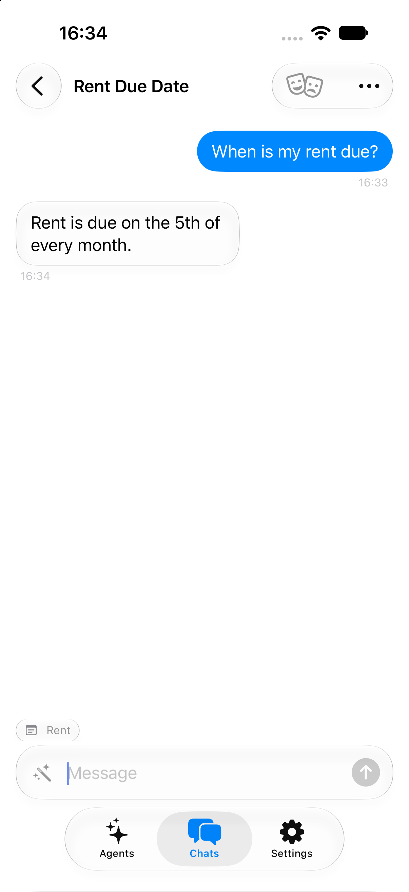
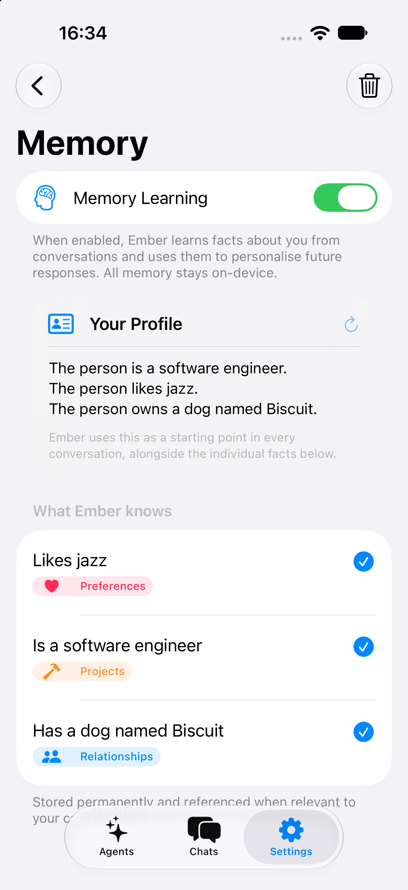
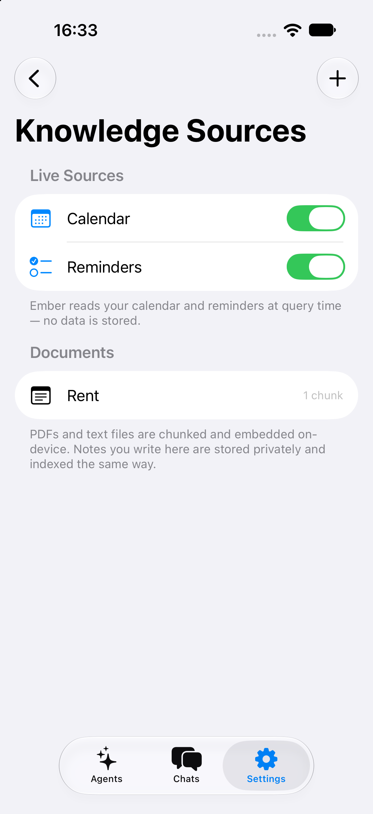
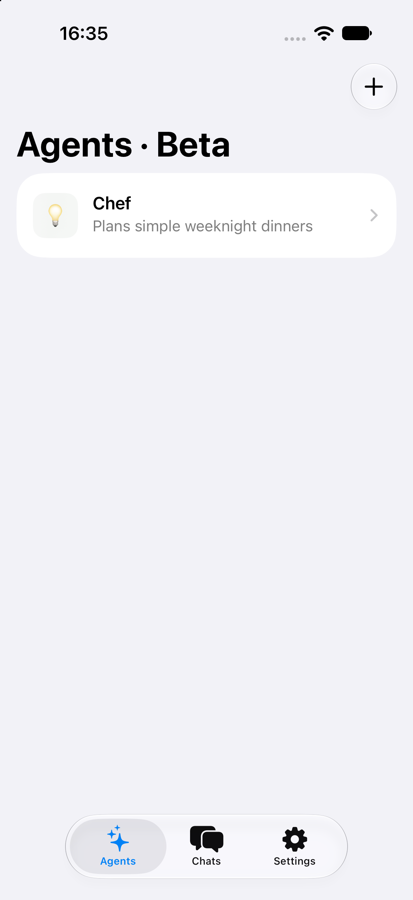

<div align="center">

# 🔥 Ember

**A private AI assistant that lives entirely on your iPhone.**

It remembers who you are, reads your notes and files, knows your calendar, and answers with Apple's on-device model. Nothing is sent to a server, because there is no server.

[](https://github.com/KushalBKusram/Ember/actions/workflows/ci.yml)
[](LICENSE)


[Website](https://kushalbkusram.github.io/Ember/) · [Changelog](CHANGELOG.md) · [Contributing](CONTRIBUTING.md)

</div>

<p align="center">
  
  
  
  
</p>

---

## Why Ember

Cloud assistants know a lot but see everything you type. Ember trades raw capability for trust:

- **Nothing leaves the device.** No account, no sync, no analytics, no tracking. Data lives in a local SQLite database.
- **It actually remembers you.** Facts are learned from your own words, de-duplicated, corrected when you correct them, and fully visible and editable in the Memory screen.
- **It shows its sources.** Answers that used your notes or the web say so, and every source can be switched off.
- **It is bounded.** Ember is a *personal knowledge assistant*, not an autonomous agent. It tells you when it doesn't know something instead of guessing.

> Ember is a hobby-scale, single-developer project. It is stable and tested, but it is not an Apple-grade product; see [Known limitations](#known-limitations).

## Features

### Core

| Feature | What it does |
|---|---|
| **Private chat** | Streaming replies from Apple Foundation Models, auto-titles, regenerate, edit-and-resend, cancel, Incognito mode |
| **Memory** | Extracts facts from *your* messages (never the assistant's), supersedes facts you correct, writes a short grounded profile |
| **Files and notes** | Import PDFs and text, or write notes in-app; chunked and embedded on-device; answers cite the source |
| **Calendar and reminders** | Read-only context at question time; says plainly when access is missing instead of claiming an empty calendar |
| **Face ID lock** | Locks the app whenever you leave it |
| **Onboarding** | Permission-by-permission, with an optional "tell Ember about you" step that seeds memory |

### Beta

These work and are tested, but are clearly labelled and not part of Ember's v1 promise.

| Feature | Notes |
|---|---|
| **Agents and scheduled jobs** | Custom agents with their own prompt and data sources; time-based and interval jobs; results arrive as notifications. Timing is controlled by iOS background refresh |
| **Web search and URL fetch** | Opt-in, off by default, DuckDuckGo with no API key. Questions about *your own* data never go to the web |
| **Image generation** | Apple Image Playground from the chat input bar |

## Requirements

- **To run Ember:** an iPhone that supports Apple Intelligence (iPhone 15 Pro or newer, A17 Pro or later) on iOS 26 or later, with Apple Intelligence turned on.
- **To build it:** Xcode 26 or later (developed on Xcode 27) and [XcodeGen](https://github.com/yonaskolb/XcodeGen).

The iOS Simulator on Xcode 27 can also run the on-device model, so you can develop and test without a phone.

## Getting started

```bash
brew install xcodegen
git clone https://github.com/KushalBKusram/Ember.git
cd Ember
xcodegen generate        # builds Ember.xcodeproj from project.yml
open Ember.xcodeproj
```

Choose an iPhone simulator (or your own iPhone) and press **Run**. To run on a device, set your own signing team in Xcode; none is committed.

### Run the tests

```bash
xcodebuild test -project Ember.xcodeproj -scheme Ember \
  -destination "platform=iOS Simulator,name=iPhone 17"
```

The suite covers memory banding, grounding of the profile, retrieval relevance, the web-search gate, source reconciliation, job scheduling and idempotency, notification routing, file-import edge cases, error reporting and more (95 tests at the time of writing).

Two evaluation suites, `SemanticRetrievalEvalTests` and `MemoryBandingEvalTests`, measure the real on-device embedding model and print `[EVAL]` lines. They need the system language asset, which headless CI runners usually lack, so CI skips them.

## How it works

```
App                      SwiftUI app, notification routing, lock gate
├── Views                SwiftUI screens (Conversation, Memory, DataSources, Agents, Settings…)
├── ViewModels           @MainActor, @Observable; one per screen
├── Services (actors)
│   ├── LLMService           prompt assembly, per-conversation session cache, streaming
│   ├── MemoryService        extraction, banding, supersession, profile synthesis
│   ├── RAGService           chunking (512 words / 50 overlap), MMR retrieval (λ 0.7)
│   ├── EmbeddingService     NLEmbedding wrapper with a SHA-256 SQLite cache
│   ├── CalendarService      EventKit read access and schedule context
│   ├── WebSearchService     DuckDuckGo HTML, intent gate, LLM-routed for agents
│   ├── WebFetchService      URL → text (HTML and PDF)
│   ├── AgentService         agents, jobs, notification scheduling
│   ├── BackgroundJobService BGAppRefreshTask runner (atomic, mutually exclusive runs)
│   └── JobRunGuard          per-job lock
├── Database             GRDB DatabasePool, migrations, file protection
└── Models               Memory, Message, RAGDocument, Agent, AgentJob, @Generable structs
```

Swift 6 with strict concurrency throughout: services are actors, view models are `@MainActor`, and there are no shared mutable globals.

### Memory

Facts are extracted from the **user's own message only** and absorbed through a three-band pipeline based on cosine similarity to what's already stored (on-device `NLEmbedding`):

| Similarity to an existing memory | Action |
|---|---|
| ≥ 0.97 | Reinforce (near-verbatim; skip the duplicate) |
| 0.70 to 0.96 | Ask the model whether the new fact *supersedes* the old one (it sees the original message, so "actually…" corrections are caught) |
| < 0.70 | Save as a new fact |

Categories are `preference`, `project`, `relationship` and `episodic` (episodic facts expire after 30 days). A short third-person profile is synthesised from the non-episodic facts, with a length guard that falls back to the plain facts if the model pads it.

The 0.97 cutoff is not arbitrary: same-shaped corrections like "works at Acme" → "now works at Globex" scored 0.92 and were once silently discarded as duplicates. See `MemoryBandTests` and `CapabilityEvalTests`.

### Retrieval

Documents and notes are retrieved with MMR. Results below a measured relevance floor (0.20 cosine; real queries score 0.19 to 0.59, small talk at most 0.17) are dropped, so "hello" doesn't recite your notes. When a web search answers a question, personal notes are not cited alongside it.

### Behavioural guarantees

Ember is built so that a single person can test and trust it:

- Repeating a tap, send or save does not create duplicate messages, jobs, notes or files.
- A failed write tells you; nothing is reported as saved when it wasn't.
- Cancel cancels. Toggles persist and take effect immediately.
- A background job run is atomic: prompt, reply and last-run stamp are written together or not at all, and two runs of one job never overlap.
- Questions about your own life are answered only from what Ember was given. Otherwise it says "I don't have that information."

## Privacy

- No analytics, no crash reporting, no accounts, no iCloud sync.
- `PrivacyInfo.xcprivacy` declares no tracking and no collected data.
- The only network paths are the opt-in web search and URL fetch, which use an ephemeral session. In DEBUG builds a `URLProtocol` sentinel asserts if anything else tries to reach the network.
- Permissions requested: Calendar, Reminders, Notifications and Face ID, each with a stated reason and each optional.

## Known limitations

- Needs an Apple Intelligence capable device; older iPhones show an unsupported-device screen.
- Semantic retrieval is only as good as Apple's built-in sentence embedding: **58% top-1 accuracy** on the bundled 12-query evaluation set. The right note usually surfaces, not always first.
- Paraphrased duplicates ("I like dark roast" / "I enjoy dark roast coffee") can be stored as separate memories.
- Scheduled jobs depend on iOS background refresh, which is not deterministic. Notifications are a fallback.
- The on-device model is small: long creative writing is shorter and plainer than a cloud model's.

## Project status

| Area | Status |
|---|---|
| Core chat, memory, files and notes, calendar and reminders, lock, onboarding | ✅ Released in 1.0 |
| Agents, scheduled jobs, web search, image generation | 🧪 Beta |
| Voice input | ❌ Not planned for v1 |

See the [CHANGELOG](CHANGELOG.md) for details.

## Contributing

Issues and pull requests are welcome. Please read [CONTRIBUTING.md](CONTRIBUTING.md) first, especially the ground rules: nothing leaves the device, behaviour stays bounded and testable, and Core features are held to a higher bar than Beta ones. Security and privacy issues go through [SECURITY.md](SECURITY.md).

## Acknowledgements

- [GRDB](https://github.com/groue/GRDB.swift) for SQLite.
- [SwiftSoup](https://github.com/scinfu/SwiftSoup) for HTML parsing.
- [XcodeGen](https://github.com/yonaskolb/XcodeGen) for the project file.
- Apple's Foundation Models, NaturalLanguage, EventKit and Image Playground frameworks.

## License

[MIT](LICENSE) © 2026 Kushal Kusram
